# GoWorth application audit and refinement

Audit date: 14 October 2026. Evidence comes from the running Expo web app in an existing authenticated test session. Screenshots below were captured during this audit and inspected after saving.

## A. Application understanding

GoWorth is an Expo SDK 57 / React Native application using Expo Router. The 20 exported web routes are thin wrappers around discovery, onboarding, trip, map, library, journal, and legal feature modules. Shared UI primitives and colors live in `src/components/goworth/ui.tsx` and `src/constants/design.ts`.

`AuthProvider` manages Supabase authentication. `TravelProvider` loads and writes account data through the Supabase repository, while device-local discovery settings and externally saved place details use AsyncStorage. Bundled destination/place catalogs and photos support discovery; map search and nearby results use OpenStreetMap-related services. The active bottom tabs are Explore, Map, Plan, Saved, and Profile. Destination, place, itinerary, budget, journal, preferences, and legal screens branch from those tabs.

No hotel booking, payment, active subscription purchase, review submission, or AI recommendation service is present in the inspected implementation. Subscription information is a legal document, not a billing flow.

## B. UX/UI issues found

| Severity | Finding and impact | Evidence |
| --- | --- | --- |
| Release blocker | Legal pages still expose operator, address, contact, retention, and transfer-safeguard placeholders. They cannot be represented as final public legal notices. | Step 11, `20-legal.jpg`, `21-privacy.jpg` |
| High | Existing bottom tabs showed icons without visible labels, leaving first-time navigation ambiguous. | Step 1, `01-home.jpg` |
| High | Editing preferences changed in-session recommendations before Save, and nearby discovery settings persisted before Save. Leaving the screen did not reliably discard a draft. | Step 8, `13-preferences.jpg` |
| High | The web shell stayed at phone width on desktop, limiting the catalog and map to a narrow column. | Step 1, baseline `01-home.jpg` and final `30-home-desktop-final.jpg` |
| Medium | Identical Nominatim results appeared repeatedly for a search such as Paris; map tiles could be partly blank while loading. | Step 5, `17-map-search-settled.jpg`, `27-map-search-320-settled.jpg` |
| Medium | Muted labels and the long test profile name were hard to scan at small sizes; desktop keyboard focus lacked a consistent brand treatment. | Steps 7-8, `07-profile-320.jpg`, `24-profile-320-after.jpg` |

## C. Improvements implemented

- Added visible, larger tab labels with 60px touch targets and increased muted-text contrast. Added web focus-visible outlines and restored 44px destination save targets.
- Widened the web shell to 960px with an 860px content cap. Destination cards now use two columns on phones, three on tablets, and four on desktop; the discovery deck stays readable at a bounded width.
- Made the existing-preferences screen identify itself as an editor, added back navigation, and kept preference and nearby-setting changes in a local draft until Save succeeds. A failed cloud save leaves the draft available for retry.
- Deduplicated identical map search labels, kept the Leaflet fallback covered until raster tiles load, and removed an incorrect static tile-provider credit below the map. Provider attribution remains inside the map.
- Centered long profile identity text, reduced excess scroll padding, and honored the `Current trip` saved-screen deep-link parameter.

## D. Flow walkthrough

1. **Explore and search - improved.** The home screen opens the discovery deck and destination catalog. Searching for Bucharest narrows the catalog to one matching destination and offers a map search. The labeled tab bar is visible at 320px and desktop widths. 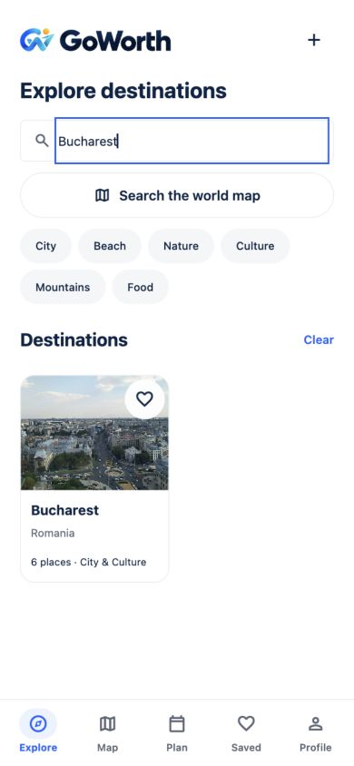 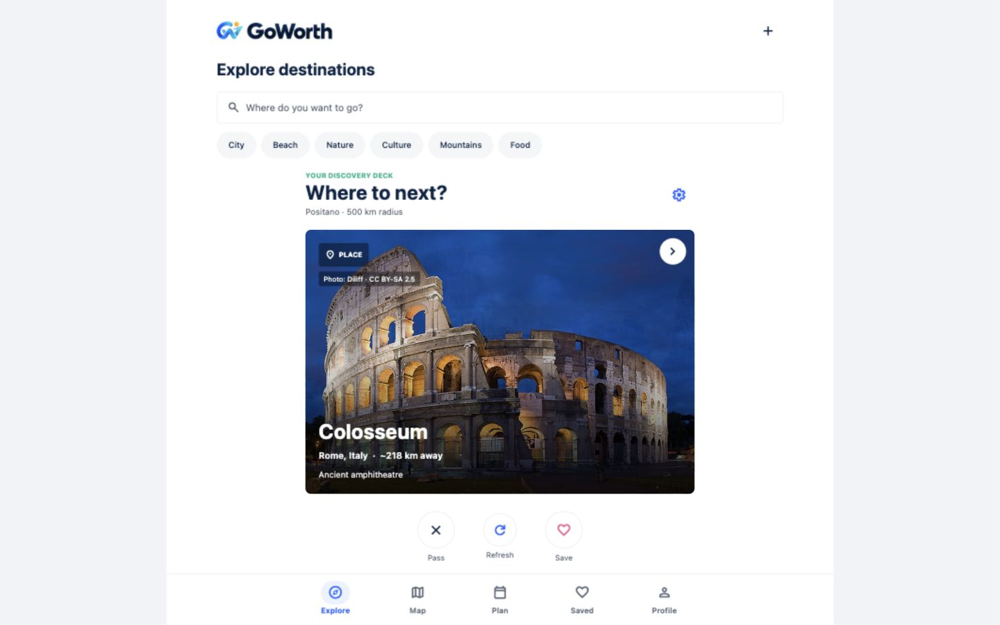
2. **Destination overview and field guide - working.** Positano opens from the catalog; Overview, Places, and Tips switch in place. The field guide has checkable tips and clear map/planning actions. Save/share actions were observed but not submitted. 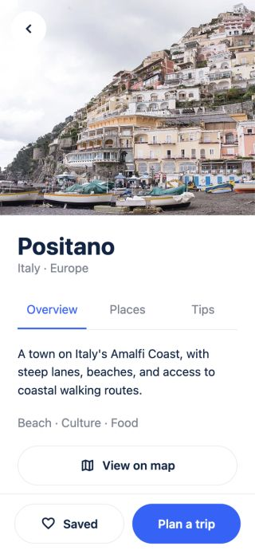 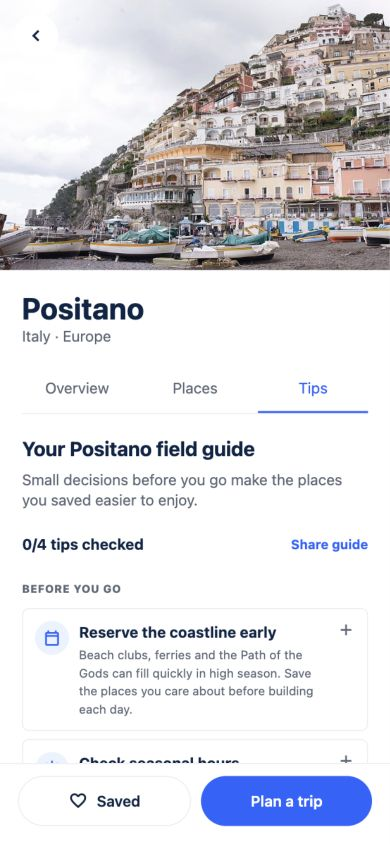
3. **Place discovery and preview - working.** View all places opens a searchable, filterable list. A place opens a bottom sheet with a loaded, credited photo and map/save/planning actions. 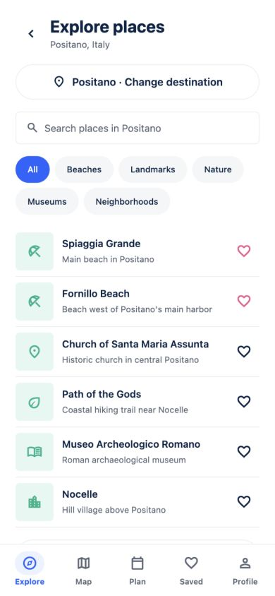 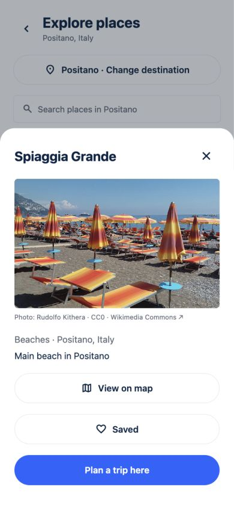
4. **Map search - improved.** The map opens through the Leaflet fallback, and a Paris search produces distinct France and Texas results instead of repeated France entries. Nearby places load below the map; initial raster loading is now covered. 
5. **Trip planner - working up to submission.** Destination, dates, budget, companions, and interests are visible. The calendar opens, and Create Trip with no dates reports a validation error. Creating or replacing a real trip was not submitted against the existing account. 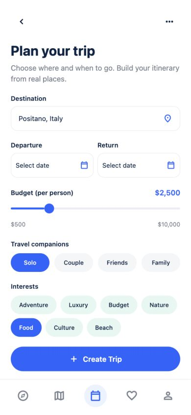 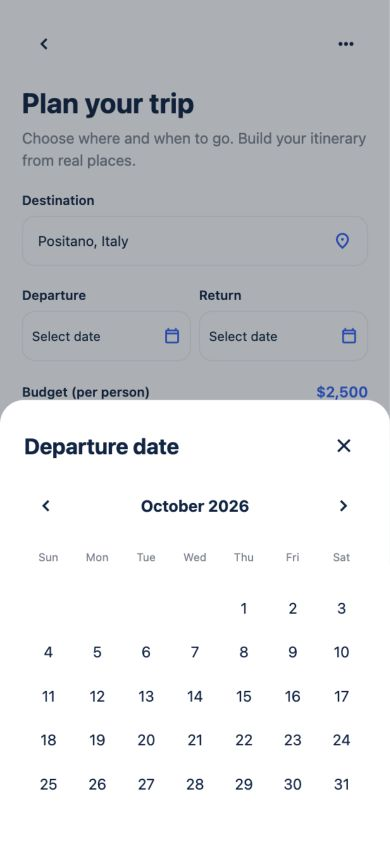
6. **Saved items - working for read-only review.** Saved destination and place tabs show the account's items; the Current trip deep link selects its empty state correctly. Unsave and persistence were not submitted. 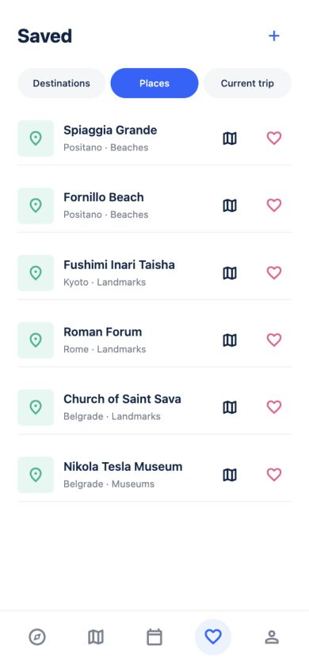 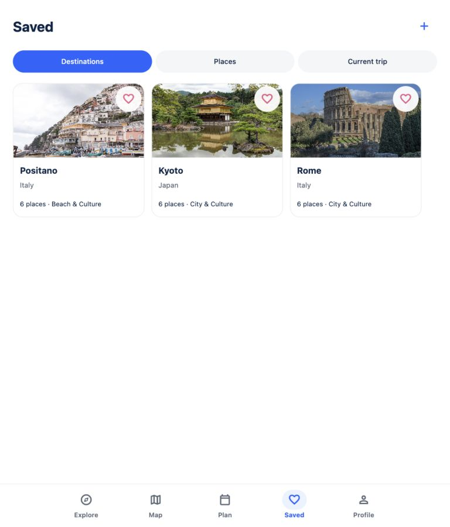
7. **Itinerary and budget - empty states working.** With no current trip, direct routes explain the prerequisite and lead back to planning. Activity and expense editing requires a trip and remains unverified.  
8. **Profile and preferences - improved.** Profile opens preferences, a draft can be changed, and leaving without Save restores the stored selection when reopened. A long profile name wraps and stays centered at 320px. Profile editing and account settings were inspected only as entry points. 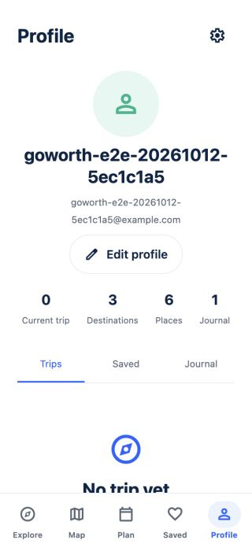 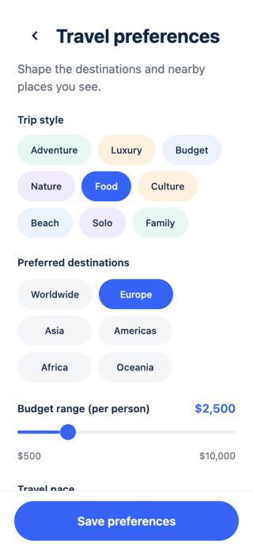
9. **Journal and trip record - working for read-only review.** The existing archived record opens from the journal and shows its dates, spending, itinerary/places empty states, and note. Edit, share, finish, and delete were not submitted. 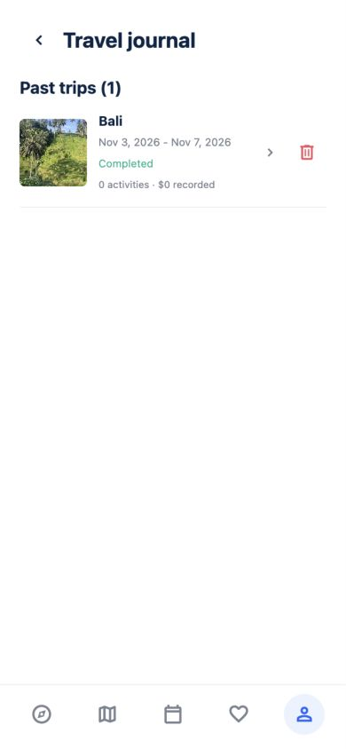 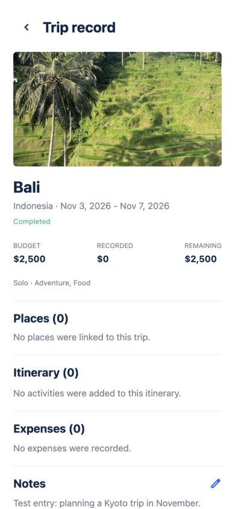
10. **Authentication/onboarding - blocked by the existing login.** The current test session redirects authenticated navigation to home. Registration, sign-in, reset email, confirmation, and first-run preferences were reviewed in code but not visually exercised in this session.
11. **Legal and data controls - release blocker.** Privacy, terms, subscription information, credits, export, and deletion entry points are present. The privacy notice visibly declares itself a draft with operator placeholders. Export and permanent deletion were not triggered. 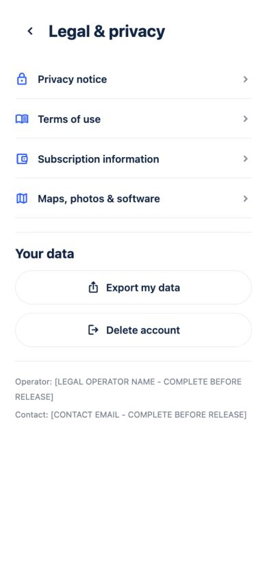 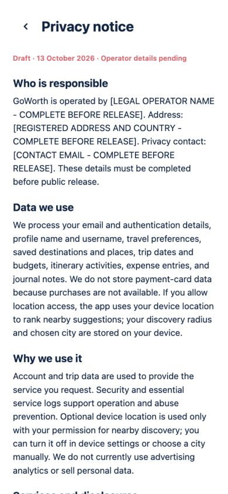

## E. Technical improvements

The preferences write now commits the supplied draft to Supabase before publishing it to shared state. Map result deduplication happens before caching. The map fallback waits for raster tiles before hiding its loading layer. Shared layout primitives provide the responsive width and navigation changes across routes without replacing existing feature logic or data contracts. No dependency or database schema was changed.

## F. Validation

- `npm run typecheck`: passed.
- `npm run lint`: passed.
- `npm test`: 18 tests passed.
- `npm run build:web`: passed; Expo exported 20 static routes.
- Browser checks: no horizontal document overflow on Explore, Plan, Saved, Profile, and Map at 375, 390, 430, 768, 1024, 1280, and 1920px. Explore and Profile were also checked at 320px; key states were visually inspected at 320, 390, 768, 1440, and 1920px.
- Browser behavior: planner missing-date validation, Paris map search, saved Current trip deep link, and discard of an unsaved preference change were observed. Browser history returned from preferences to profile.

These checks do not establish full accessibility compliance. Native iOS/Android rendering, screen-reader announcements, reduced-motion behavior, account registration/recovery, database mutations, and destructive actions were not end-to-end tested. The authenticated account had no current trip, so itinerary and expense editing could only be checked in their empty states. The browser used Leaflet fallback; MapLibre and native WebView behavior remain unverified.

## G. Remaining recommendations

1. Replace the legal placeholders with the actual operator identity, address, contact, retention periods, and transfer details, then obtain legal review before public release.
2. Run a disposable-account end-to-end pass for sign-up, confirmation, recovery, trip creation/replacement, itinerary and expense edits, save/unsave, export, journal actions, and account deletion.
3. Check iOS and Android on physical devices, including permission prompts, safe areas, screen readers, font scaling, reduced motion, and offline/error recovery.
4. Add automated accessibility and visual regression coverage around the shared tab bar, sheets, date picker, and responsive destination grids.
